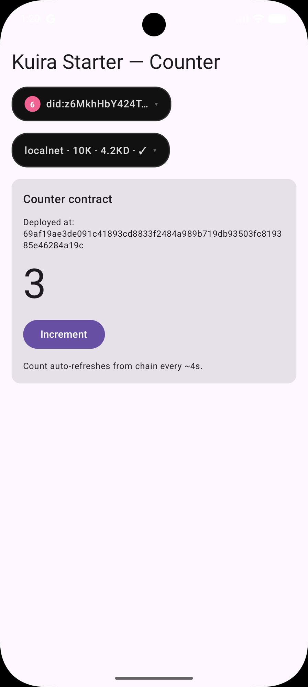

<section class="kuira-hero" markdown>
<canvas class="kuira-hero__canvas" data-component="starfield" aria-hidden="true"></canvas>

<div class="kuira-hero__inner" markdown>
<div class="kuira-hero__eyebrow"><span>Kuira · v{{ kuira_version }}</span><span>Maven Central</span></div>

<h1 class="kuira-hero__headline">Zero-knowledge apps that <em>prove on the phone</em>: no server, no seed phrase.</h1>

<p class="kuira-hero__lede">
Kuira is the Android SDK for Midnight, with the full private-app stack and self-custody: on-device ZK proving, passkey identity, an embedded wallet, and the Compact runtime. Every recipe ships a one-tap prompt for your coding agent.
</p>

<div class="kuira-hero__cta">
<a href="#templates" class="md-button md-button--primary">Get started</a>
<a href="integration/" class="md-button">Read the integration guide</a>
<a href="https://github.com/kuiralabs/kuira-starter-android" class="md-button">Clone the starter</a>
</div>
</div>

<a class="kuira-hero__scroll" href="#templates" aria-label="Scroll to examples">
<svg viewBox="0 0 24 24" aria-hidden="true"><path d="M7 10l5 5 5-5"/></svg>
</a>
</section>

<section class="kuira-templates" id="templates" markdown>

<div class="kuira-templates__header" markdown>
<h2 class="kuira-templates__title">Try it now: clone a working dApp</h2>
<p class="kuira-templates__subtitle">
The fastest way in: a complete, runnable app you make your own. Copy the prompt into your coding agent, and it clones the repo and walks through the setup as a task list you can watch.
</p>
</div>

<div class="kuira-templates__grid" markdown>

<article class="kuira-template" markdown>

<div class="kuira-template__body" markdown>
<span class="kuira-template__eyebrow">Starter</span>
<h3 class="kuira-template__title">Kuira Starter</h3>
<p class="kuira-template__desc">
A minimal counter dApp: Sigil identity, embedded wallet, and a 6-line Compact contract you deploy and increment on-chain. ~700 lines, also a GitHub template.
</p>
<div class="kuira-template__actions" data-copy-prompt="https://raw.githubusercontent.com/kuiralabs/kuira-starter-android/main/README.md" data-task="Clone the Kuira Starter Android template and get it running on a device, then help me customize it."></div>
</div>
</article>

<article class="kuira-template" markdown>

<div class="kuira-template__body" markdown>
<span class="kuira-template__eyebrow">Example</span>
<h3 class="kuira-template__title">Midnight Kicks</h3>
<p class="kuira-template__desc">
A ZK penalty shootout on Unity 3D and Kotlin, with a Compact contract as the on-chain referee. Commit-reveal so neither side can cheat, and every move is proved on the phone.
</p>
<div class="kuira-template__actions" data-copy-prompt="https://raw.githubusercontent.com/kuiralabs/midnight-kicks/main/README.md" data-task="Clone the Midnight Kicks example and get it running on a device, then help me customize it."></div>
</div>
</article>

</div>

<div class="kuira-templates__more" markdown>
[See all examples →](examples.md){ .md-button }
</div>

</section>

<section class="kuira-picker" id="kuira-picker" markdown>
<div class="kuira-picker__header" markdown>
<h2 class="kuira-picker__title">Already have an app? Add Kuira with your agent</h2>
<p class="kuira-picker__subtitle">
Integrating Kuira into an existing project, or following a specific recipe? Pick a task and your agent. The page generates the prompt, you paste it in, and the agent works through the steps as a task list.
</p>
</div>

<div class="kuira-picker__row" markdown>
<span class="kuira-picker__label">What do you want to build?</span>
<div class="kuira-picker__options" role="radiogroup" aria-label="Recipe">
<button class="kuira-picker__chip" type="button" role="radio" aria-pressed="true" data-task-key="add-kuira-to-an-android-project" data-task-title="Add the Kuira SDK">Add Kuira to a project</button>
<button class="kuira-picker__chip" type="button" role="radio" aria-pressed="false" data-task-key="bind-your-app-to-a-passkey-domain" data-task-title="Bind your app to a passkey domain">Bind to a passkey domain</button>
<button class="kuira-picker__chip" type="button" role="radio" aria-pressed="false" data-task-key="set-up-sigil-identity" data-task-title="Set up Sigil identity">Set up Sigil identity</button>
<button class="kuira-picker__chip" type="button" role="radio" aria-pressed="false" data-task-key="hello-compact" data-task-title="Write a minimal Compact contract">Hello Compact</button>
<button class="kuira-picker__chip" type="button" role="radio" aria-pressed="false" data-task-key="deploy-and-call-a-compact-contract" data-task-title="Deploy a Compact contract and call a circuit">Deploy a Compact contract</button>
<button class="kuira-picker__chip" type="button" role="radio" aria-pressed="false" data-task-key="run-kuira-doctor" data-task-title="Wire and run kuiraDoctor preflight">Run kuiraDoctor</button>
</div>
</div>

<div class="kuira-picker__row" markdown>
<span class="kuira-picker__label">For your agent</span>
<div class="kuira-picker__options" role="radiogroup" aria-label="Agent">
<button class="kuira-picker__chip" type="button" role="radio" aria-pressed="true" data-agent-key="claude" data-agent-name="Claude Code">Claude Code</button>
<button class="kuira-picker__chip" type="button" role="radio" aria-pressed="false" data-agent-key="cursor" data-agent-name="Cursor">Cursor</button>
<button class="kuira-picker__chip" type="button" role="radio" aria-pressed="false" data-agent-key="codex" data-agent-name="Codex">Codex</button>
<button class="kuira-picker__chip" type="button" role="radio" aria-pressed="false" data-agent-key="generic" data-agent-name="any LLM">Generic LLM</button>
</div>
</div>

<div class="kuira-picker__output" markdown>
<span class="kuira-picker__label">Your prompt</span>
<pre class="kuira-picker__prompt" id="kuira-picker-output" aria-live="polite">Building prompt…</pre>
<div class="kuira-picker__actions">
<button class="kuira-picker__action kuira-picker__action--primary" type="button" id="kuira-picker-copy"><span aria-hidden="true">📋</span> Copy prompt</button>
<a class="kuira-picker__action" id="kuira-picker-raw" href="#" target="_blank" rel="noopener"><span aria-hidden="true">📄</span> View raw context bundle</a>
</div>
</div>
</section>

<section class="kuira-features" markdown>
<article class="kuira-feature" markdown>
<span class="kuira-feature__eyebrow">Identity</span>
<h3 class="kuira-feature__title">Passkey-derived sigil</h3>
<p class="kuira-feature__body">
One biometric mints a DID and wallet seed through a PRF on the passkey assertion. There is no seed phrase at onboarding, and the sigil is recoverable on any device that shares the Google account.
</p>
</article>
<article class="kuira-feature" markdown>
<span class="kuira-feature__eyebrow">Wallet</span>
<h3 class="kuira-feature__title">Embedded, no custodian</h3>
<p class="kuira-feature__body">
Shielded and unshielded balances, transaction balancing, indexer sync, and Dust regeneration. The wallet lives in your app's process; you never call out to a separate wallet.
</p>
</article>
<article class="kuira-feature" markdown>
<span class="kuira-feature__eyebrow">Contracts</span>
<h3 class="kuira-feature__title">Compact runtime + ZK proving</h3>
<p class="kuira-feature__body">
Deploy and call Compact circuits on-device. QuickJS contract runtime, witness packing, per-circuit proving keys, and transaction submission, wired by a Gradle plugin.
</p>
</article>
</section>

<section class="kuira-modules" markdown>
<div class="kuira-modules__title">16 modules · pull <code>dapp-ui</code>, get the graph</div>
<div class="kuira-modules__list">
<span class="kuira-modules__pill">dapp-ui</span>
<span class="kuira-modules__pill">midnight-sdk</span>
<span class="kuira-modules__pill">wallet-runtime</span>
<span class="kuira-modules__pill">wallet-seed</span>
<span class="kuira-modules__pill">identity</span>
<span class="kuira-modules__pill">auth</span>
<span class="kuira-modules__pill">crypto</span>
<span class="kuira-modules__pill">compact-engine</span>
<span class="kuira-modules__pill">indexer</span>
<span class="kuira-modules__pill">connector</span>
<span class="kuira-modules__pill">ledger</span>
<span class="kuira-modules__pill">network</span>
<span class="kuira-modules__pill">wallet</span>
<span class="kuira-modules__pill">designsystem</span>
<span class="kuira-modules__pill">testing</span>
<span class="kuira-modules__pill">contract-plugin</span>
</div>
</section>

## Install

=== "Gradle (Kotlin DSL)"

    ```kotlin
    // settings.gradle.kts
    dependencyResolutionManagement {
        repositories {
            mavenCentral()
        }
    }

    // app/build.gradle.kts
    dependencies {
        implementation("io.github.kuiralabs:dapp-ui:{{ kuira_version }}")
    }
    ```

=== "Gradle (Groovy)"

    ```groovy
    // settings.gradle
    dependencyResolutionManagement {
        repositories {
            mavenCentral()
        }
    }

    // app/build.gradle
    dependencies {
        implementation 'io.github.kuiralabs:dapp-ui:{{ kuira_version }}'
    }
    ```

`dapp-ui` `api`-exposes the consumer surface, so a single line gives you the complete SDK graph. Drop in the prebuilt wallet and sigil pills, or build your own UI on the same public contracts. If you need no Compose at all, use `midnight-sdk`. → [Choose your level](integration.md#choose-your-level)

[Full integration guide →](integration.md){ .md-button .md-button--primary }
[Security & verification](security.md){ .md-button }

Four working example dApps you can clone and run: [see all examples →](examples.md).

---

## Built for AI-assisted development

The cookbook is the source of truth for both humans and agents. Every recipe is a raw Markdown file at a stable URL that agents fetch directly. A site-root [`/llms.txt`](llms.txt) lists every recipe, following the emerging [llms.txt](https://llmstxt.org) convention.

For maintainers: the SDK source lives in a private repository. Source jars ship next to every AAR on Maven Central, so you can read, audit, or step into the implementation through any IDE.

---

## Known limitations · {{ kuira_version }}

These are the places the SDK doesn't reach yet. None of them block the "identity + wallet + contract call" core path; each will close in a future release.

| Gap | Workaround today | Closes in |
|---|---|---|
| **No Compact authoring deep-dive on the Kuira side**: the SDK consumes compiled `.compact` artifacts but does not teach the full Compact language. Witnesses, ZK patterns, selective-disclosure idioms, and multi-party state are covered in the Midnight project's documentation, not Kuira's. | Start with the [Hello Compact](recipes/hello-compact.md) recipe for the minimum-viable counter and the toolchain pin matrix, then follow it to the [official Midnight contract examples](https://github.com/midnightntwrk/midnight-docs/tree/main/docs/examples/contracts) for everything beyond. | Closed by intent: the Kuira SDK is the runtime; the Midnight project owns the language. |
| **SDK source not browsable on GitHub**: the Dokka API reference doesn't link to source. | A `-sources.jar` ships next to every artifact on Maven Central. Android Studio and IntelliJ attach it automatically, so you can step into the implementation as usual. | By design: sources travel with the artifacts |
| **BLS proving params from Midnight's dev S3 bucket**: `midnight-s3-fileshare-dev-eu-west-1`, a supply-chain assumption labeled "dev." | None. This sits at the protocol-team layer; per-contract proving keys are unaffected (each dApp hosts its own). | When Midnight publishes a production URL |
| **Android only**: no iOS, no React Native bridge, no JS interop. | If you need cross-platform, build the same surface twice for now. | iOS support is planned |

For security-domain gaps (what the threat model does and doesn't cover, such as compromised devices, malicious co-process dApps, and session-cache theft), see [Security](security.md) § What Kuira does not protect against.

---

## What's coming next: Sigil V2

The currently shipped sigil architecture (**Sigil V1**) derives the wallet seed deterministically from a passkey PRF assertion. That gives one-tap onboarding but binds the sigil to a single WebAuthn `rpId`, so a user's funds cannot be shared across multiple Kuira apps that ship under different domains, and recovery depends on the same Google account holding the synced passkey.

**Sigil V2** keeps one-tap onboarding but treats the master seed as portable data: PRF becomes an *unlock key* for a persisted seed envelope rather than the seed itself. Three properties follow:

- **Cross-app sigil portability via explicit enrollment.** A user installs a second Kuira app, taps "Use my Kuira sigil from \[Wallet]," and the existing app hands the seed over a secure, biometric-gated AIDL channel. Both apps then share the same wallet, the same DID, and the same on-chain history.
- **Cross-device, cross-Google-account recovery.** PIN-based recovery through an opaque cloud bucket (the Signal SVR2 pattern, with no enclave needed); the seed survives device loss and account changes.
- **Midnight Passport plug-in path.** A versioned envelope codec, a storage-tier interface, and a frozen HKDF signer namespace reserve a clean integration surface for Midnight's protocol-native account abstraction, universal DID, and verifiable-credential layers once Passport's spec is public.

Dashlane, Bitwarden, 1Password, Signal SVR2, and WhatsApp E2EE backups already ship the same primitive in production: five independent systems that converged on the same shape for the same reason.

Sigil V2 is the **next architecture** for Kuira, not the next alpha. The master-seed lifecycle, tiered storage, and cross-app enrollment come first; cloud-bucket PIN recovery follows.

---

## License

Apache License 2.0. See [LICENSE](https://github.com/kuiralabs/kuira-sdk-android/blob/main/LICENSE).
